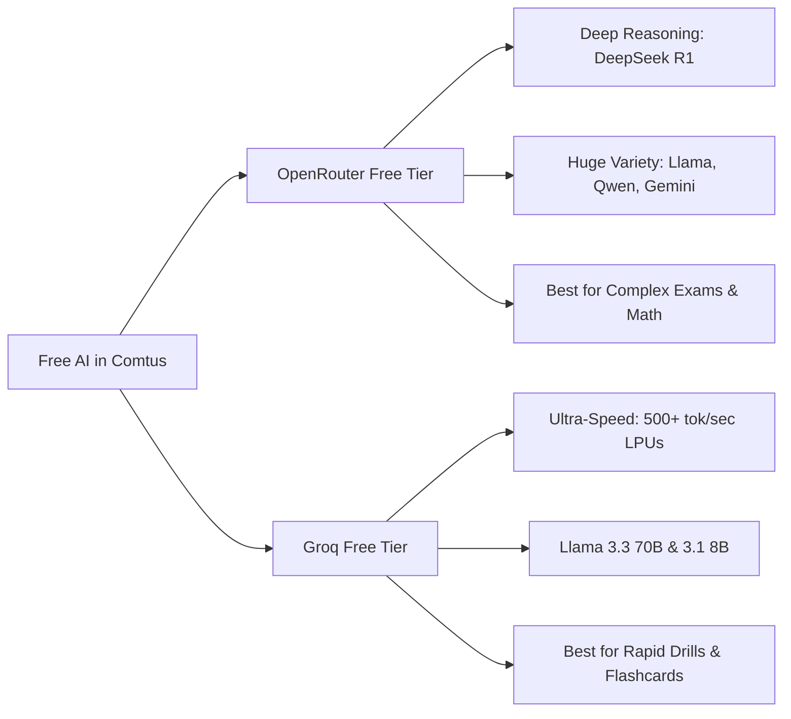

# Comtus AI: Free Models & BYOK Guide (OpenRouter vs. Groq)

> **Comtus Studio** gives you access to two top free AI providers with a **recurring self-updating model catalog**, plus an optional **Smarter Models Tier (Claude Opus 5 & Sonnet 5)** via PayPal usage passes.

---

## 🚀 Concise Summary for First-Time Users

If you are new to Comtus and want free AI, here is the 30-second summary:

| Choose Provider | Why Pick It? | Best Free Model to Select | Best For |
| :--- | :--- | :--- | :--- |
| **✨ OpenRouter (Free)** | Deep reasoning, high intelligence, largest model variety | `deepseek/deepseek-r1:free` or `meta-llama/llama-3.3-70b-instruct:free` | Complex 100-item mock board exams, step-by-step logic, math, long readings |
| **⚡ Groq (Fast Free)** | World-record speed (~500+ tokens/sec on LPU hardware) | `llama-3.3-70b-versatile` or `llama-3.1-8b-instant` | Instant flashcards, rapid-fire study drills, fast question answering |
| **👑 Smarter Tier (Claude)** | Deepest frontier reasoning, adaptive thinking (BYOK disabled) | `claude-opus-5` or `claude-sonnet-5` (Hosted Key · PayPal Pass) | Highest-stakes exam review (PNLE, LET, CE Board, USMLE, Bar) |

---

## 1. Side-by-Side Comparison: OpenRouter vs. Groq (Free Tiers)

| Feature | OpenRouter (Free Tier) | Groq (Free Tier) |
| :--- | :--- | :--- |
| **Primary Strength** | Model variety & deep step-by-step reasoning | Extreme inference speed (zero latency) |
| **Inference Speed** | Standard / Queued (~30–60 tokens/sec) | ⚡⚡⚡ **Blazing Fast (500–800 tokens/sec)** |
| **Top Free Reasoner** | `deepseek/deepseek-r1:free` (Full thinking trace) | `llama-3.3-70b-versatile` (Fast analytical power) |
| **Top General Model** | `meta-llama/llama-3.3-70b-instruct:free` | `llama-3.3-70b-versatile` |
| **Long Context Option** | `google/gemini-2.0-flash-exp:free` (Up to 1M tokens) | Up to 128k context |
| **Free API Key Signup** | [openrouter.ai/keys](https://openrouter.ai/keys) | [console.groq.com/keys](https://console.groq.com/keys) |
| **Cost** | **$0 / 100% Free** | **$0 / 100% Free** |

---

## 2. Recurring Self-Updating Model Catalog

You never have to worry about outdated model names or broken endpoints:

1. **Automatic Live Synchronization**: When you open **Settings** or switch between OpenRouter and Groq, Comtus automatically polls the live `GET /models` API in the background.
2. **Instant Discovery of New Free Models**: Whenever OpenRouter releases a new `:free` model or Groq updates its engine, it automatically surfaces in your dropdown.
3. **One-Click Quick Filters**: Filter the live list by:
   - `✨ :free (OpenRouter Free)`
   - `⚡ Groq (Llama)`
   - `DeepSeek`
   - `Qwen`
   - `Gemini`

---

## 3. Quick Setup Guide for First-Time Users (60 Seconds)

### Option A: Using OpenRouter (Deep Reasoning)
1. Sign up at [openrouter.ai](https://openrouter.ai) and go to [openrouter.ai/keys](https://openrouter.ai/keys).
2. Click **Create Key**, name it `Comtus Study`, and copy your key (`sk-or-v1-...`).
3. Open **Settings** in Comtus, select **OpenRouter & Free Models (BYOK)**.
4. Click the **OpenRouter (Free)** card.
5. Paste your key, select `deepseek/deepseek-r1:free` (or `openrouter/auto`), and click **Save & test**.

### Option B: Using Groq (Ultra Speed)
1. Sign up at [console.groq.com](https://console.groq.com) and go to [console.groq.com/keys](https://console.groq.com/keys).
2. Click **Create API Key**, copy your key (`gsk_...`).
3. Open **Settings** in Comtus, select **OpenRouter & Free Models (BYOK)**.
4. Click the **Groq (Fast Free)** card.
5. Paste your key, select `llama-3.3-70b-versatile`, and click **Save & test**.

---

## 4. Smarter Models Tier: Claude Opus 5 & Sonnet 5 (PayPal Usage Pass)

For high-stakes study where you need the world's most capable reasoning models:

- **Anthropic BYOK is Disabled**: You don't need an Anthropic developer account or credit card commitments.
- **Hosted Managed Key**: Claude Opus 5 & Sonnet 5 run directly on our managed key.
- **Realistic PayPal Pricing**: Pay only for your actual usage. Passes are metered in **hosted requests**, not tokens.

| Study Pass | Price (USD) | Hosted requests | Window | What it covers |
| :--- | :--- | :--- | :--- | :--- |
| **Sprint Pass** | **$2.99** | **60** | 60 days | A short burst of Opus/Sonnet chats and mock exams |
| **Scholar Pass** *(Most Popular)* | **$6.99** | **200** | 120 days | A term of adaptive reasoning and full mock exams |
| **Mastery Pass** | **$14.99** | **500** | 180 days | Opus 5 deep synthesis and a full semester review |

---

## 5. ⚠️ Mandatory AI Disclaimer: Double-Check Your Sources

> [!WARNING]
> ### 🛑 Critical Verification Protocol
> **AI models can make mistakes, hallucinate answers, and misinterpret textbook nuances.**
>
> - **Always Double-Check**: Always verify AI-generated answers, rationales, and calculations against your primary textbooks, clinical nursing manuals, or legal codes.
> - **Source Grounding**: Comtus cites exact source passages (`[Title] · ¶X`). Click any citation to inspect the original text.
> - **Licensure Exams**: Do not rely exclusively on AI for high-stakes licensure exams without primary source verification.
